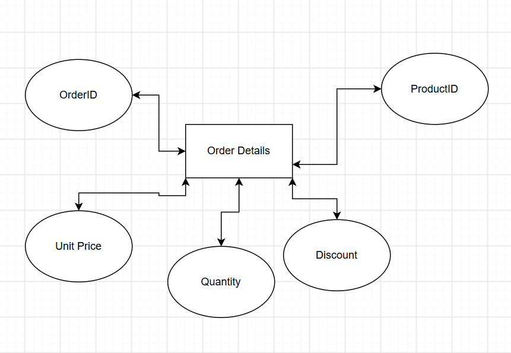

1. Create an Entity-Relationship Diagram (ERD) showing entities, attributes, and relationships.
You may:
Hand-draw the ERD and take a clear photo.
OR use a digital tool (e.g., Figma, Canva, draw.io) and take a screenshot.


2. Save the image and place it in your “Task 4” folder.

3. SQL Schema (reference Northwind Database; same database used in Geek Week)
Write CREATE TABLE statements for at least three entities, including:
Primary keys (PK)
Foreign keys (FK)
Appropriate data types and NOT NULL constraints.

Please add your SQL query below AND add an explanation: 

```-- 1. Categories Table (Strong Entity)
CREATE TABLE Categories (
    CategoryID INT IDENTITY(1,1) NOT NULL,
    CategoryName VARCHAR(15) NOT NULL,
    Description TEXT NULL,
    CONSTRAINT PK_Categories PRIMARY KEY (CategoryID)
);

-- 2. Suppliers Table (Strong Entity)
CREATE TABLE Suppliers (
    SupplierID INT IDENTITY(1,1) NOT NULL,
    CompanyName VARCHAR(40) NOT NULL,
    ContactName VARCHAR(30) NULL,
    Country VARCHAR(15) NULL,
    CONSTRAINT PK_Suppliers PRIMARY KEY (SupplierID)
);

-- 3. Products Table (Dependent Entity linking Categories and Suppliers)
CREATE TABLE Products (
    ProductID INT IDENTITY(1,1) NOT NULL,
    ProductName VARCHAR(40) NOT NULL,
    SupplierID INT NOT NULL,
    CategoryID INT NOT NULL,
    QuantityPerUnit VARCHAR(20) NULL,
    UnitPrice DECIMAL(10,2) DEFAULT 0.00 NOT NULL,
    UnitsInStock SMALLINT DEFAULT 0 NOT NULL,
    CONSTRAINT PK_Products PRIMARY KEY (ProductID),
    CONSTRAINT FK_Products_Suppliers FOREIGN KEY (SupplierID) REFERENCES Suppliers(SupplierID),
    CONSTRAINT FK_Products_Categories FOREIGN KEY (CategoryID) REFERENCES Categories(CategoryID)
);

[Insert Code Here]
```
```
[Insert Explanation Here]
```

4. For submission, commit and push.
